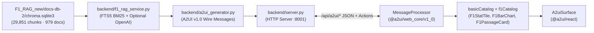

# F1 RAG · A2UI v1.0 Telemetry Dashboard

An interactive generative UI dashboard built with the **A2UI v1.0** framework (`@a2ui/react`, `@a2ui/web_core/v1_0`, and `@a2ui/markdown-it`) for exploring, querying, and inspecting the Formula 1 RAG dataset stored in `../F1_RAG_new` (**979** Wikipedia HTML articles and **29,851** ChromaDB vector chunks).

Instead of hardcoding rigid response views, the Python backend acts as an A2UI agent that emits declarative **A2UI v1.0** wire protocol messages (`createSurface`, component adjacency lists, `@path` data bindings, and bidirectional `action` events), which the React client validates and renders natively through `MessageProcessor` and `<A2uiSurface />`.

---

## Architecture



---

## Features

- **Corpus Telemetry (`f1-overview` surface):** Live KPI tiles (`29,851` vector chunks, `979` F1 articles, average chunks/doc, `text-embedding-ada-002` collection metadata), domain breakdown bar chart across 7 F1 categories, and densest articles with one-click `inspect_document` A2UI actions.
- **RAG Query (`f1-rag-answer` surface):** Natural-language F1 Q&A powered by ChromaDB SQLite FTS5 (BM25) retrieval—no API key required—with optional OpenAI GPT synthesis when `OPENAI_API_KEY` (or the UI key input) is provided. Each retrieved chunk renders as an interactive `F1PassageCard` with relevance score and source drill-down.
- **Knowledge Explorer (`f1-doc-inspector` surface):** Filter and search all 979 indexed F1 Wikipedia articles by category or title and inspect their stored ChromaDB chunks.
- **A2UI Wire JSON Inspector:** Toggleable side panel displaying the live A2UI v1.0 protocol payloads (`version: "v1.0"`, `createSurface`, `components`, `dataModel`) exchanged with the backend.

---

## Project Structure

```text
a2ui-demo/
├── backend/
│   ├── f1_rag_service.py   # Read-only ChromaDB SQLite queries, FTS5 BM25 retrieval, optional OpenAI synthesis
│   ├── a2ui_generator.py   # A2UI v1.0 surface & component message builder
│   └── server.py           # Zero-dependency Python HTTP server (default port 8001)
├── frontend/
│   ├── index.html          # App entry HTML & F1 typography (Titillium Web, Inter, JetBrains Mono)
│   ├── package.json        # @a2ui/react, @a2ui/web_core, @a2ui/markdown-it, zod, lucide-react
│   ├── vite.config.ts      # Vite dev server (:5173) with /api proxy to :8001
│   └── src/
│       ├── f1Catalog.tsx   # Custom A2UI v1.0 catalog (F1StatTile, F1BarChart, F1PassageCard)
│       ├── App.tsx         # MessageProcessor setup, A2uiSurface rendering, bidirectional actions
│       ├── index.css       # F1 Pit-Wall dark telemetry theme
│       └── main.tsx        # React 19 root mount
└── README.md
```

---

## Custom A2UI Catalog (`f1Catalog`)

Alongside the standard A2UI `basicCatalog` (`Column`, `Row`, `Card`, `Text`, `Button`), [frontend/src/f1Catalog.tsx](frontend/src/f1Catalog.tsx) registers three domain-specific components with Zod schemas:

| Component | Purpose | Key Props |
| :--- | :--- | :--- |
| `F1StatTile` | Pit-wall KPI telemetry card | `label`, `value`, `sublabel`, `accent` (`red` \| `teal` \| `amber` \| `blue`) |
| `F1BarChart` | Horizontal domain distribution chart | `title`, `items` (`{ name, count }[]` or `@path` binding) |
| `F1PassageCard` | Ranked RAG evidence passage card | `rank`, `title`, `source`, `category`, `score`, `content`, `action` |

---

## Backend API Endpoints

| Method | Endpoint | Description |
| :--- | :--- | :--- |
| `GET` | `/api/health` | Health check returning `{ "status": "ok", "protocol": "a2ui-v1.0" }` |
| `GET` | `/api/a2ui/overview` | Returns A2UI `f1-overview` surface messages and corpus statistics |
| `POST` | `/api/a2ui/query` | Accepts `{ "question": "...", "k": 8, "openaiApiKey"?: "..." }` and returns `f1-rag-answer` A2UI messages |
| `GET` | `/api/a2ui/document` | Accepts `?source=...&title=...` and returns `f1-doc-inspector` A2UI messages |
| `POST` | `/api/a2ui/action` | Handles bidirectional A2UI `action` payloads (`inspect_document`, `ask_question`) |
| `GET` | `/api/docs` | Lists indexed F1 documents with optional `?category=`, `?search=`, and `?limit=` filters |

---

## Getting Started

### Prerequisites

- **Python 3.9+** (standard library only; no external `pip` packages required)
- **Node.js 20+** and **npm**
- **`F1_RAG_new` dataset** located at `../F1_RAG_new` (relative to the repository root), or configured via `F1_RAG_DIR`

### 1. Start the Python A2UI Backend

```bash
python3 backend/server.py
```

The server listens on `http://127.0.0.1:8001`.

**Optional environment variables:**
- `PORT` — Override the backend port (default: `8001`; update `frontend/vite.config.ts` if changed)
- `F1_RAG_DIR` — Path to the `F1_RAG_new` directory if stored elsewhere
- `OPENAI_API_KEY` — Enables OpenAI (`gpt-4o-mini`) answer synthesis over retrieved ChromaDB chunks

### 2. Start the React + A2UI Frontend

```bash
cd frontend
npm install
npm run dev
```

Open **`http://localhost:5173`** in your browser.

---

## Verification

- **Frontend build:** `cd frontend && npm run build` (`tsc -b && vite build`)
- **A2UI schema validation:** Backend-generated `f1-overview`, `f1-rag-answer`, and `f1-doc-inspector` payloads are validated against `@a2ui/web_core/v1_0`'s `MessageProcessor` with `basicCatalog` and `f1Catalog`.
